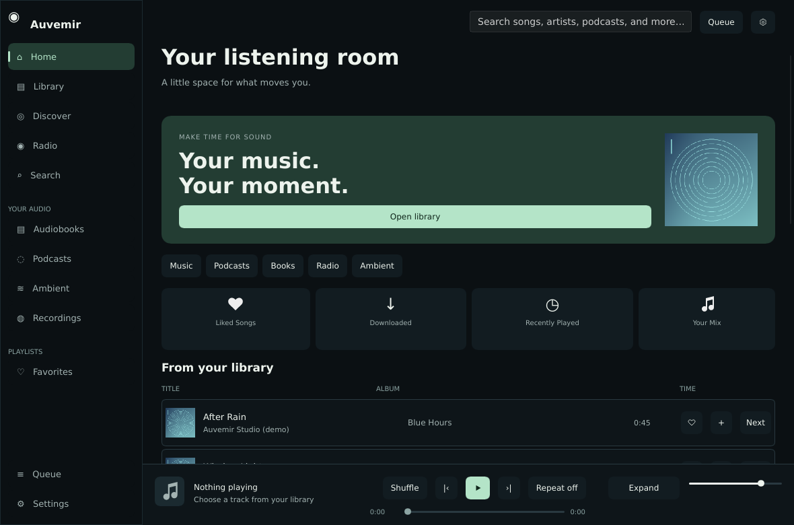
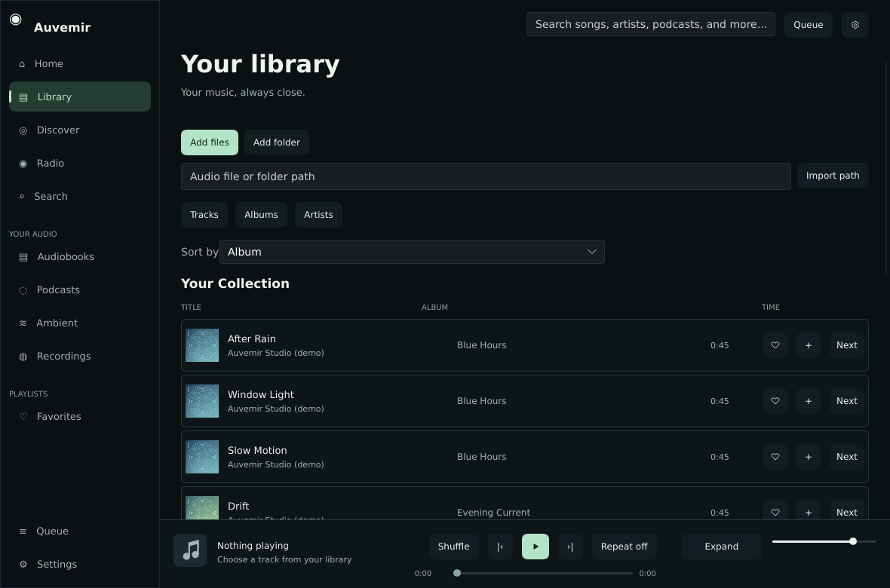
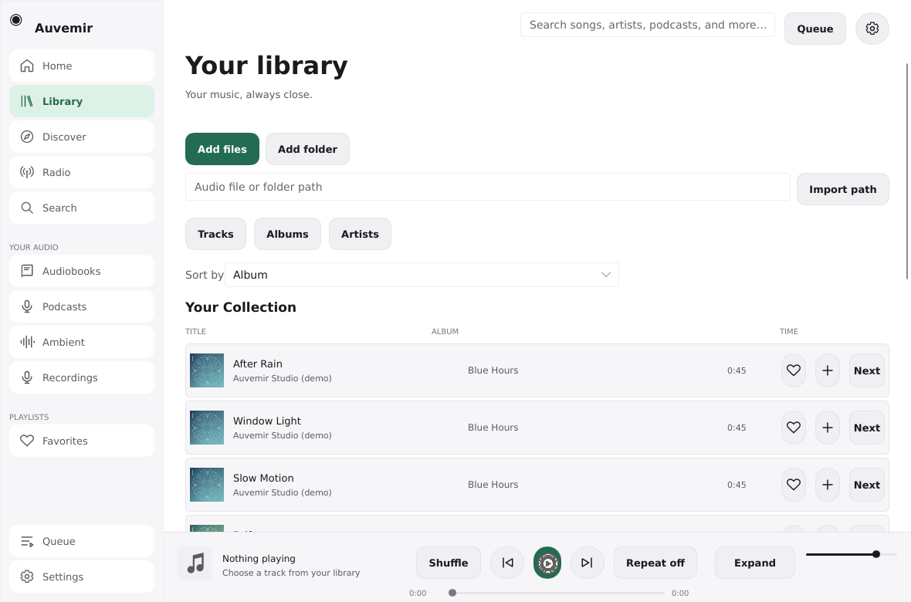
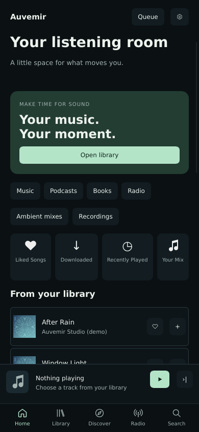
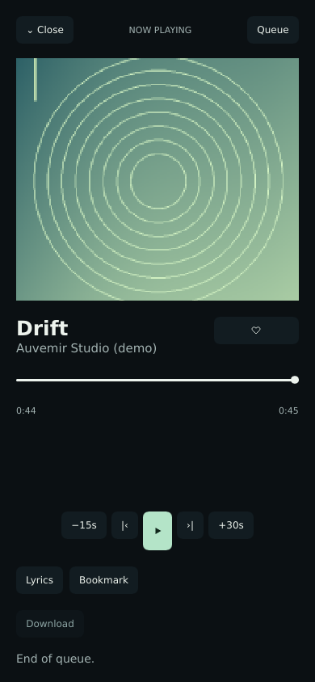
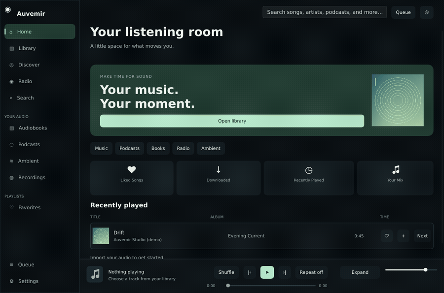

# Auvemir

### Your audio, in one calm space.

A native **Rust and Slint audio player** for your local music library, personal music servers, audiobooks, podcasts, internet radio, ambient mixes and recordings. Keep your files, choose your services, and make room for listening.

[](https://github.com/deactivated0/Auvemir/actions/workflows/ci.yml)
[](LICENSE)
[](Cargo.toml)
[](crates/desktop/Cargo.toml)



**Development preview:** build and verification results are documented honestly. Source support for desktop, Android and iOS does not imply signing, receiver validation or physical-device certification. See [verification](docs/TRANSFORMATION.md), [platform status](docs/PLATFORMS.md) and [feature details](docs/FEATURES.md).

[Get started](#get-started) · [User guide](docs/USAGE.md) · [Build and package](docs/BUILDING.md) · [Contribute](CONTRIBUTING.md)

## Made for your listening

- **Your collection comes first.** Incremental imports, album/artist/title/duration sorting, literal search, favorites, playlists and restored queues.
- **One place for long listens.** Resume audiobooks and podcasts, create bookmarks, browse embedded MPEG-4 chapters and set a sleep timer.
- **A quieter interface.** Responsive desktop and phone layouts, persistent light or dark appearance, grouped settings and restrained subtitle motion that respects reduced motion.
- **Connections are your choice.** Personal servers, public catalogs and opt-in metadata services. Credentials use native secure storage, with no plaintext fallback or telemetry.

## Inside the app

| Library | Light appearance |
| --- | --- |
|  |  |

| Phone home | Expanded player |
| --- | --- |
|  |  |

These are real application captures using twelve generated demo tracks and procedural covers. Phone captures exercise the responsive Linux renderer; they do not certify mobile hardware. Reproduce them with the [capture guide](docs/CAPTURES.md).

<details>
<summary>See navigation and subtitle motion</summary>



A short recording of the implemented interface. This GIF is not a frame-rate benchmark.
</details>

## Capabilities

| Area | What you can do |
| --- | --- |
| Local library | Import files or folders, cancel imports, see progress and warnings, sort and search, browse groups, edit tags atomically and manage playlists. Failed scan batches do not mark uncommitted files as scanned. |
| Playback | Native CPAL output, local seeking, volume, shuffle/repeat, queue reordering, ten-band EQ and pitch-preserving speed from 0.5× to 2×. |
| Formats | Native MP3, MP2, FLAC, WAV, Vorbis, AAC, ALAC, AIFF and mono/stereo Ogg Opus. Optional system FFmpeg supplies additional decoders after native decoding fails. |
| Personal servers | Navidrome/Subsonic, WebDAV/Nextcloud folder browsing, Audiobookshelf libraries/tracks/progress and configurable Invidious search/trending. Results are paged. |
| Spoken audio and radio | LibriVox, podcast directory search, RSS/Atom subscriptions, OPML, Radio Browser failover, custom stations and radio M3U/JSON import/export. |
| Downloads | One active transfer, progress, pause, validated HTTP Range resume, disk-space checks, 2 GiB limit, atomic completion and BLAKE3 manifests. |
| Ambient and recording | Generated noise, imported loops, per-layer volume, saved presets, explicit microphone start, pause/resume, level meter and recoverable WAV recording. |
| Lyrics and metadata | Local LRC, LRCLIB synchronized lyrics, timing adjustments, MusicBrainz, native AcoustID fingerprints, artwork providers and playlist metadata imports. API credentials are user supplied. |
| Optional sharing | Encrypted metadata sync, encrypted Listen Together rooms with matching local audio, Chromecast control/relay, iOS AirPlay routing and desktop Discord presence. |
| Listening services | Opt-in durable scrobbling for ListenBrainz-compatible services, Last.fm, Libre.fm and Maloja; JSON history backup and listening analytics. |

Authenticated services, casting receivers, microphone hardware and mobile device behavior need their corresponding environments. Read the [feature matrix](docs/FEATURES.md) for implementation limits, including remote whole-book seeking and server bookmark sync.

## Get started

Use **Rust 1.99.0**, C/C++, CMake and Clang/libclang. The lockfile fixes dependency versions.

On Debian/Ubuntu:

```sh
git clone https://github.com/deactivated0/Auvemir.git
cd Auvemir
rustup toolchain install 1.99.0 --profile minimal --component rustfmt --component clippy
sudo apt install build-essential cmake clang libclang-dev pkg-config libasound2-dev libfontconfig1-dev libxkbcommon-dev libxkbcommon-x11-0 libx11-dev
cargo +1.99.0 build --locked --release -p auvemir -j 2
./target/release/auvemir
```

Open **Library → Add files / Add folder**, or type a file/folder path. You can also launch `auvemir /path/to/audio`. Imports run in the background; canceling keeps completed batches. Open **Settings → Appearance and motion** to choose light/dark appearance or reduced motion.

Linux packages built on Ubuntu 24.04 require **glibc 2.39+**. File dialogs use an XDG desktop portal; typed paths are also available. Windows requires MSVC, CMake and LLVM. macOS requires Xcode command-line tools, CMake and LLVM. See [platform build, packaging and signing instructions](docs/BUILDING.md).

## Shortcuts and preferences

Use Ctrl on Linux/Windows or Command on macOS.

| Shortcut | Action |
| --- | --- |
| Ctrl/Command + F | Search |
| Ctrl/Command + O | Add audio |
| Ctrl/Command + J | Queue |
| Ctrl/Command + , | Settings |
| Ctrl/Command + 1 / 2 | Home / Library |
| Ctrl/Command + / | Shortcut guide |
| Space | Play/pause outside text entry |
| Escape | Close panels |
| Ctrl/Command + Q | Quit with normal cleanup |

Sorting, appearance and reduced-motion overrides persist locally. Playlists and queues retain their intentional ordering. The system motion preference is sampled at startup; the in-app override takes effect immediately.

## Connect your services

Settings groups connections, playback, appearance, files, metadata, sync/rooms and casting. Choose a music connection from Discover. A first-run community Invidious entry can be removed or replaced in Settings; removing it persists. Catalog requests start when you open those sections. Invidious availability depends on the chosen instance; restricted/premium content is not supported, and online music downloads are not provided.

Subsonic/WebDAV use a password; Audiobookshelf and ListenBrainz-compatible services use an API token. Last.fm/Libre.fm expect JSON credentials. Native Secret Service, Windows Credential Manager, Apple Keychain or Android KeyStore stores secrets. Credential-backed connections cannot be saved when secure storage is unavailable. Authenticated redirects stay on the configured host and TLS verification remains enabled. Explicitly configured HTTP servers are allowed; use HTTPS for transport confidentiality. See [connection and privacy details](docs/USAGE.md).

## Develop and verify

```sh
cargo +1.99.0 fmt --all --check
cargo +1.99.0 clippy --locked --release --workspace --all-targets -- -D warnings
cargo +1.99.0 test --locked --release --workspace
cargo +1.99.0 build --locked --release -p auvemir -j 2
python3 tests/verify_codecs.py target/release/auvemir --extended
python3 tests/verify_desktop.py target/release/auvemir
python3 tools/capture_screenshots.py target/release/auvemir
```

Native UI verification and capture need Python/Pillow, FFmpeg, Xvfb, xauth and xdotool on Linux. They run against disposable demo profiles. CI runs native Rust checks on Linux, Windows and macOS, with Linux journeys and capture artifacts. Mobile and release workflows are included separately. [Performance evidence and remaining limitations](docs/TRANSFORMATION.md) distinguish measurements from expectations.

`crates/core` owns SQLite, scanning, queues, feeds, catalogs, downloads, server protocols, lyrics and sync. `crates/desktop` owns Slint, audio/DSP, artwork, recording, native credentials and system controls. `ui` holds reusable native components and design tokens. No Electron or embedded browser is used.

## Troubleshooting

| Symptom | Check |
| --- | --- |
| Build cannot find ALSA or libclang | Install native dependencies and set `LIBCLANG_PATH` to LLVM's library directory; use `-j 1` on memory-constrained machines. |
| File dialog does not open | Install your desktop's XDG portal; enter a path directly while diagnosing the portal. |
| A connection cannot save | Start/unlock your operating system's credential store. There is no insecure fallback. |
| A catalog fails | Check network access and the configured server; community endpoints can go offline. Local playback remains available. |
| Unsupported audio format | Install system FFmpeg and retry, or inspect with `auvemir --decode FILE`. |
| Startup or data issue | Run with `RUST_LOG=auvemir=debug`; `AUVEMIR_DATA_DIR` selects a separate profile. Back up existing data before manual changes. |

## Contributing and license

See [CONTRIBUTING.md](CONTRIBUTING.md) for focused changes and verification. Report reproducible issues without account secrets or private media.

**GPL-3.0-only.** Slint uses its GPL option. Dependencies retain their licenses, including LGPL-2.1 SoundTouch. Corresponding-source packaging and notices are described in [THIRD_PARTY_NOTICES.md](THIRD_PARTY_NOTICES.md). System FFmpeg is optional and not bundled. No commercial audio, account credentials or user libraries are included.
